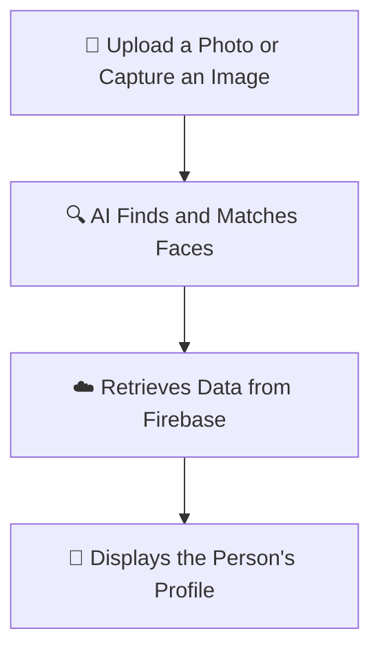

# Face Recogniser
### AI-Powered Face Recognition & Sports Profile Intelligence

**Recognise faces. Discover profiles. Connect identities with data.**

A Python-based face recognition web application that identifies registered individuals from images or camera captures and displays their associated sports profiles using an interactive Streamlit interface and Firebase backend.

<br>


</div>

---

## ✨ About the Project

Face Recogniser combines computer vision, facial feature encoding, and cloud-based data management in one interactive application.

Instead of simply detecting a face, the system compares facial encodings against registered individuals and retrieves their associated information. Its sports-oriented profiles can include statistics for **Cricket, NBA, and Football**.

Whether an administrator is managing registered profiles or a user is identifying someone from a photograph, the application provides a simple interface for the entire workflow.

> 💡 **The idea:** Turn facial recognition into a profile discovery experience by connecting computer vision with structured cloud data.

## 🔥 Key Features

<table>
<tr>
<td width="50%" valign="top">

### 🎯 Intelligent Recognition
- Facial detection and encoding
- Matching against registered identities
- Multiple-face image processing
- Face labels and bounding boxes
- Handling for unknown or possible matches

</td>
<td width="50%" valign="top">

### ☁️ Cloud-Powered Backend
- Firebase Firestore integration
- Firebase Storage for profile images
- Cached face data for repeated use
- Persistent profile metadata
- Cloud-backed registration workflow

</td>
</tr>
<tr>
<td width="50%" valign="top">

### 🛡️ Admin Control Center
- Register new individuals
- Generate face encodings
- Update profile details
- Replace images and encodings
- Delete profiles and filter records

</td>
<td width="50%" valign="top">

### 🏆 Sports Intelligence
- Cricket player profiles
- NBA player profiles
- Football player profiles
- Personal and physical details
- Sport-specific statistics

</td>
</tr>
</table>


## 🧠 How It Works

The application follows a simple three-step process:



1. **Capture an Image:** Upload a photo or take a picture using the camera.
2. **Recognise the Face:** The AI compares the face with registered faces stored in the system.
3. **Display the Profile:** If a match is found, the application displays the person's name and available sports statistics.

**In short:** Upload a photo → Recognise the face → View the profile.


### The Recognition Pipeline

1. **Capture:** The user uploads an image or takes a picture using the camera interface.
2. **Detect:** The application locates faces in the image.
3. **Encode:** The `face_recognition` library converts detected faces into numerical feature representations.
4. **Compare:** The encodings are compared with those of registered individuals.
5. **Retrieve:** When a match is found, the corresponding profile is retrieved from the database.
6. **Display:** The interface shows the identification result and available profile information.

## 🛠️ Tech Stack

<div align="center">

| Technology | Role in the Project |
|:---|:---|
| 🐍 **Python** | Core application logic |
| 👁️ **face_recognition** | Face detection, encoding and matching |
| 📷 **OpenCV** | Image processing and recognition annotations |
| 🎨 **Streamlit** | Interactive web application |
| 🔢 **NumPy** | Numerical processing of image and encoding data |
| 🖼️ **Pillow** | Image loading and conversion |
| 🔥 **Firebase Admin SDK** | Secure backend integration |
| ☁️ **Cloud Firestore** | Face encodings and profile metadata |
| 🗄️ **Firebase Cloud Storage** | Registered profile images |
| 🐼 **Pandas** | Tabular profile management |

</div>

## 🏗️ Application Architecture

```text
                   ┌─────────────────────┐
                   │    Streamlit UI     │
                   └──────────┬──────────┘
                              │
                ┌─────────────┴─────────────┐
                │                           │
        ┌───────▼────────┐         ┌────────▼────────┐
        │   Admin Panel  │         │   User Panel    │
        │ Register/Manage│         │ Upload / Camera │
        └───────┬────────┘         └────────┬────────┘
                │                           │
                ▼                           ▼
        ┌─────────────────┐        ┌─────────────────┐
        │ Face Encoding   │        │ Face Matching   │
        └────────┬────────┘        └────────┬────────┘
                 │                          │
                 └────────────┬─────────────┘
                              ▼
                    ┌──────────────────┐
                    │ Firebase Backend │
                    ├──────────────────┤
                    │ Cloud Firestore  │
                    │ Cloud Storage    │
                    └────────┬─────────┘
                             ▼
                    ┌──────────────────┐
                    │ Profile & Result │
                    └──────────────────┘
```

## 🏅 Supported Sports Profiles

The application can associate recognised identities with sport-specific information.

| Category | Example statistics |
|:---|:---|
| 🏏 Cricket | Total runs, total wickets |
| 🏀 NBA | Points per game, playing position |
| ⚽ Football | Goals scored, goals saved |
| 👤 General | Name, age, height and other available metadata |

*The displayed statistics depend on the information stored for each profile.*

## 📂 Project Structure

```text
face-recogniser/
│
├── app.py                  # Main Streamlit application
├── requirements.txt        # Project dependencies
├── sso_logo.jpg            # Application logo (verify filename)
├── .streamlit/
│   └── secrets.toml        # Local configuration — do not commit
└── README.md               # Project documentation
```

## 🚀 Getting Started

Get the project running locally in a few steps.

### 1. Clone the repository

```bash
git clone https://github.com/yuvanshkalra/face-recogniser.git
cd face-recogniser
```

### 2. Create a virtual environment

```bash
python -m venv venv
```

Activate it:

**Windows PowerShell**
```powershell
.\venv\Scripts\Activate.ps1
```

**macOS / Linux**
```bash
source venv/bin/activate
```

### 3. Install dependencies

```bash
python -m pip install --upgrade pip
pip install -r requirements.txt
```

> ⚙️ **Installation tip:** `face_recognition` depends on `dlib`, which may require additional system libraries or build tools. If installation fails, consult the installation instructions for both packages for your operating system and Python version.

### 4. Configure Firebase

Before running the app:

- Create a Firebase project.
- Enable Cloud Firestore and Firebase Storage.
- Create a service account with the required permissions.
- Obtain the service-account JSON and Storage bucket name.
- Configure your Streamlit secrets using the keys expected by `app.py`.

Create `.streamlit/secrets.toml` and enter your actual configuration. Keep this file private.

```toml
[firebase]
service_account_json = '''
PASTE_YOUR_COMPLETE_SERVICE_ACCOUNT_JSON_HERE
'''
storage_bucket = "YOUR_FIREBASE_STORAGE_BUCKET"
firestore_collection = "YOUR_FIRESTORE_COLLECTION"

[admin]
username = "your_admin_username"
password = "your_admin_password"

[users]
user1_username = "your_first_username"
user1_password = "your_first_password"
user2_username = "your_second_username"
user2_password = "your_second_password"
```

Ensure the service-account value contains the complete JSON object in the format expected by the application. The collection and credential key names must match the implementation in `app.py`.

### 5. Launch the application

```bash
streamlit run app.py
```

Open the local address printed in the terminal, typically:

**http://localhost:8501**

Log in using the credentials configured for your application.

## 🖥️ Application Modules

### 👨‍💼 Admin Panel
Manage the recognition database by registering new faces, maintaining profile information, replacing images, and removing records.

### 👤 User Panel
Identify registered individuals from an uploaded image or camera capture and view the profile information available for the detected person.

### 🗃️ Firebase Data Layer
Store and retrieve facial encodings, metadata, and profile images through Firebase services.

## 🔐 Security & Responsible Use

Facial data is sensitive biometric information. A responsible deployment should:

- Never commit Firebase credentials or passwords.
- Restrict database and storage access using appropriate permissions and security rules.
- Use strong credentials and improve authentication before public deployment.
- Obtain appropriate consent before collecting or processing facial images.
- Avoid exposing personal information and face encodings to unauthorised users.
- Treat recognition as a possible match, not definitive proof of identity.

**Note:** The project's secrets-based login is a basic access mechanism, not a replacement for production-grade authentication and authorisation.

## ⚠️ Current Limitations

- Recognition works against registered identities; it does not identify every person on the internet.
- Results can vary with lighting, image quality, facial pose, and occlusion.
- Camera recognition processes captured images rather than providing continuous live-video tracking.
- Profile completeness depends on the data entered by the administrator.
- A face match does not establish real-world identity with certainty.

## 🔮 Future Enhancements

- [ ] Real-time webcam recognition
- [ ] More robust authentication and role-based access
- [ ] Duplicate-face detection during registration
- [ ] Improved unknown-person rejection and threshold validation
- [ ] Profile search, filters and exportable reports
- [ ] Automated tests and structured error logging
- [ ] Improved deployment configuration and monitoring

## 👨‍💻 Author

<div align="center">

### **Yuvansh Kalra**

[](https://github.com/yuvanshkalra)

*Building with AI, computer vision, and Python.*

</div>

## 📄 License

No license is documented in this README. Check the repository for an existing license before redistributing or reusing the project.

---

<div align="center">

**⭐ If you find this project interesting, consider starring the repository!**

*Built with Python · Streamlit · Computer Vision · Firebase*

</div>
