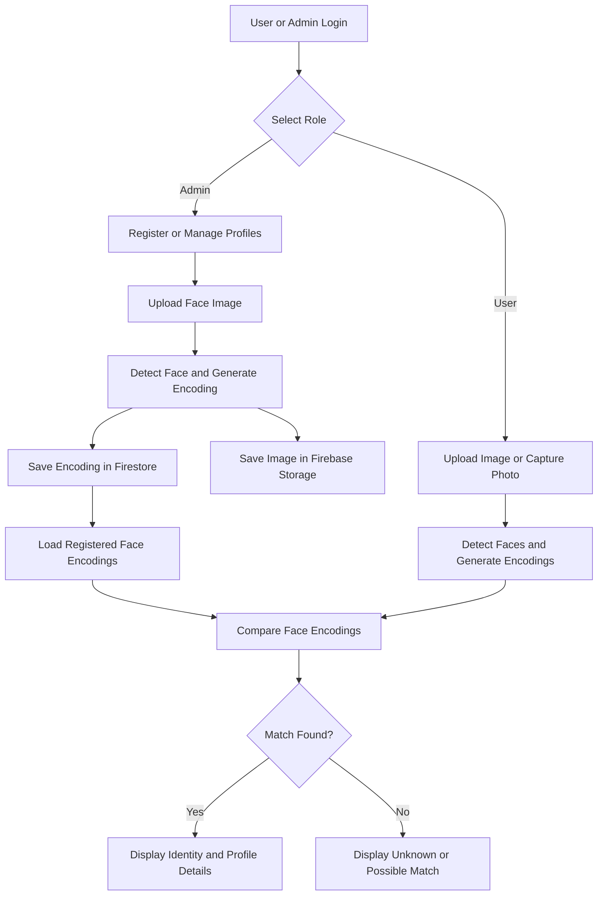

# Face Recogniser — AI-Powered Face Recognition System

A web-based face recognition application built with **Python, Streamlit, OpenCV, the `face_recognition` library, and Firebase**. The application identifies registered people from uploaded images or camera captures and displays their associated profile information, including sports statistics.

Developed for **SSO Consultants**.

## ✨ Features

### 🔍 Face Recognition
- Recognise registered people from uploaded images.
- Capture an image using the camera directly from the application.
- Detect multiple faces in a single image.
- Draw bounding boxes and identification labels around detected faces.
- Display `Unknown` or a possible match when a confident identification cannot be established.

### 👤 User Dashboard
- Separate user login.
- Choose between camera capture and image upload.
- View identified individuals and their available profile details.
- Display additional statistics based on the person's sport.
- Log out securely through the application interface.

### 🛠️ Admin Dashboard
- Separate administrator login.
- Register new people using an image upload.
- Generate face encodings for recognition.
- View registered profiles in a tabular interface.
- Update personal information and sport-specific statistics.
- Replace a registered person's image and corresponding face encoding.
- Delete profiles with a confirmation step.
- Filter registered profiles by sport.

### 🏆 Sports Profile Management
The application supports the following sports categories:

| Sport | Available profile details |
|---|---|
| Cricket | Total runs and total wickets |
| NBA | Points per game and playing position |
| Football | Goals scored and goals saved |
| Other | General profile information |

Common profile fields include name, age, and height. Fields are displayed when the corresponding data is available.

### ☁️ Firebase Integration
- **Cloud Firestore:** Stores face encodings and profile metadata.
- **Firebase Cloud Storage:** Stores the registered profile images.
- **Cached data loading:** Uses Streamlit resource caching to reduce repeated database reads.
- **Dynamic updates:** Refreshes the cached face database after administrative changes.

---

## 🧰 Tech Stack

| Technology | Purpose |
|---|---|
| Python | Core application logic |
| Streamlit | Interactive web interface |
| `face_recognition` | Face detection, encoding, and matching |
| OpenCV | Image processing and drawing recognition labels |
| NumPy | Image arrays and numerical operations |
| Pillow | Image loading and conversion |
| Firebase Admin SDK | Backend integration |
| Cloud Firestore | Face encodings and profile metadata |
| Firebase Cloud Storage | Profile image storage |
| Pandas | Tabular display of registered profiles |

---

## 🏗️ How It Works

The application follows a face registration and recognition workflow.



### Recognition Pipeline

1. An administrator registers a person with a name, sport, and image.
2. The application detects faces and generates numerical face encodings.
3. The encoding and associated metadata are stored in Firestore, while the image is uploaded to Firebase Storage.
4. Registered encodings are loaded and cached for subsequent recognition requests.
5. A user uploads an image or captures a photo.
6. The application compares detected face encodings with registered encodings.
7. Matching identities are labelled on the processed image, and available profile information is shown in the sidebar.

**Important:** This is a face identification system, not an object detector or a speech-recognition application.

---

## 📁 Project Structure

```text
face-recogniser/
│
├── app.py                 # Main Streamlit application
├── requirements.txt       # Python dependencies
├── sso_logo.jpg           # Application logo expected by the UI
└── .streamlit/
    └── secrets.toml       # Local Firebase and login configuration
```

The `.streamlit/secrets.toml` file is a local configuration file that you create; it should not be committed with real credentials.

---

## 🚀 Installation and Setup

### 1. Clone the repository

```bash
git clone https://github.com/yuvanshkalra/face-recogniser.git
cd face-recogniser
```

### 2. Create a virtual environment

```bash
python -m venv venv
```

Activate it on Windows:

```powershell
.\venv\Scripts\Activate.ps1
```

Or on macOS/Linux:

```bash
source venv/bin/activate
```

### 3. Install dependencies

Upgrade pip and install the packages specified by the repository:

```bash
python -m pip install --upgrade pip
pip install -r requirements.txt
```

**Installation note:** The `face_recognition` package depends on `dlib`, which can require additional build tools or compatible prebuilt packages. If installation fails, check the Python version, operating system, and the installation instructions for `dlib` and `face_recognition`.

### 4. Configure Firebase

In the Firebase Console:

1. Create or select a Firebase project.
2. Enable **Cloud Firestore**.
3. Set up **Cloud Storage**.
4. Create a service account with appropriate permissions.
5. Download its service-account JSON file securely.
6. Note the Firebase Storage bucket name and decide on a Firestore collection name.

The application reads the Firebase service-account JSON, Storage bucket, and collection name from Streamlit secrets.

### 5. Configure Streamlit secrets

Create the following file in the project directory:

`.streamlit/secrets.toml`

Add the configuration below, replacing all placeholders with your own values.

```toml
[firebase]
service_account_json = '''
{
  "type": "service_account",
  "project_id": "YOUR_PROJECT_ID",
  "private_key_id": "YOUR_PRIVATE_KEY_ID",
  "private_key": "YOUR_PRIVATE_KEY",
  "client_email": "YOUR_SERVICE_ACCOUNT_EMAIL",
  "client_id": "YOUR_CLIENT_ID",
  "token_uri": "https://oauth2.googleapis.com/token"
}
'''
storage_bucket = "YOUR_FIREBASE_STORAGE_BUCKET"
firestore_collection = "YOUR_FIRESTORE_COLLECTION"

[admin]
username = "your_admin_username"
password = "replace_with_a_strong_admin_password"

[users]
user1_username = "your_first_username"
user1_password = "replace_with_a_strong_password"

user2_username = "your_second_username"
user2_password = "replace_with_another_strong_password"
```

**Configuration requirements:**
- Use the complete service-account JSON provided by Firebase, not the abbreviated example above.
- Keep the private key and passwords secret.
- The application expects the administrator credentials under `[admin]` and user credentials under `[users]`.
- Give the service account only the permissions needed for Firestore and Storage.
- Configure Firestore and Storage security rules appropriately.

### 6. Run the application

```bash
streamlit run app.py
```

Open the local URL shown in the terminal, usually:

```text
http://localhost:8501
```

Choose either **Login as User** or **Login as Admin** from the home screen.

---

## 🗄️ Database Design

### Firestore

The application reads and writes profile documents in the collection specified by `firestore_collection`.

A typical document contains fields similar to the following:

```json
{
  "name": "Example Athlete",
  "encoding": ["face-encoding-values"],
  "age": 28,
  "height": "180 cm",
  "sport": "Cricket",
  "total_runs": 5000,
  "total_wickets": 120,
  "image_storage_path": "known_faces_images/example_1234.jpg",
  "timestamp": "Firestore server timestamp"
}
```

This is an illustrative schema. Sport-specific fields are optional and depend on the registered person's category.

The `encoding` field stores the numerical face representation generated by the recognition library. It is not the original image.

### Firebase Storage

Registered profile images are stored under:

```text
known_faces_images/
```

Each stored image has a unique filename, and its storage path is recorded in the corresponding Firestore document.

---

## 🧪 Recognition and Matching

The application uses face encodings to compare an input face with registered faces.

- `face_recognition.face_locations()` detects faces.
- `face_recognition.face_encodings()` generates face representations.
- `face_recognition.compare_faces()` checks matches using the library's tolerance setting.
- `face_recognition.face_distance()` measures the distance between encodings.

The implementation also handles a close-but-not-confirmed match separately, displaying `Possibly [name]` when the best face distance is below its additional threshold of `0.6`.

Recognition results depend on image quality, lighting, facial pose, and the quality of the registered reference images. The threshold is not a guarantee of identity.

---

## 🔐 Security and Privacy

This project handles biometric data and personal information, so deployment requires care.

- Never commit `.streamlit/secrets.toml` or service-account credentials.
- Add local secrets and virtual-environment directories to `.gitignore`.
- Use strong passwords and restrict access to administrator functions.
- Configure Firebase IAM permissions and database/storage rules.
- Collect and process facial images only with appropriate consent and a lawful purpose.
- Avoid exposing face encodings, personal metadata, or uploaded images publicly.
- Consider stronger authentication and server-side access controls before using the application in production.

The application's username/password checks use Streamlit secrets. They should not be treated as a complete production-grade authentication system.

---

## ⚠️ Limitations

- Recognition is limited to identities registered in the database.
- Accuracy can decrease with poor lighting, occlusion, extreme angles, or low-resolution images.
- The camera workflow captures an image for processing; it is not a continuous real-time video stream.
- The registration workflow uses the first face encoding found in an uploaded image. Use a clear image containing one intended person when registering a profile.
- Profile details depend on the metadata entered by the administrator.
- Firebase connectivity and correctly configured credentials are required.
- The application does not establish a person's real-world identity with certainty.

---

## 🔮 Future Improvements

- Add continuous webcam recognition with live video processing.
- Introduce stronger authentication, role-based authorization, and audit logs.
- Add batch registration and duplicate-profile detection.
- Improve unknown-person handling and tune matching thresholds using validation data.
- Add profile search, pagination, and exportable reports.
- Add automated tests and structured application logging.
- Improve deployment configuration and secrets management.

---

## 👨‍💻 Author

**Yuvansh Kalra**

GitHub: [@yuvanshkalra](https://github.com/yuvanshkalra)

Project: [Face Recogniser](https://github.com/yuvanshkalra/face-recogniser)

---

## 📄 License

No license has been specified here. Check the repository for an existing license before reusing or distributing the project.

---

<p align="center">
  Built with Python, Streamlit, OpenCV, and Firebase.
</p>
